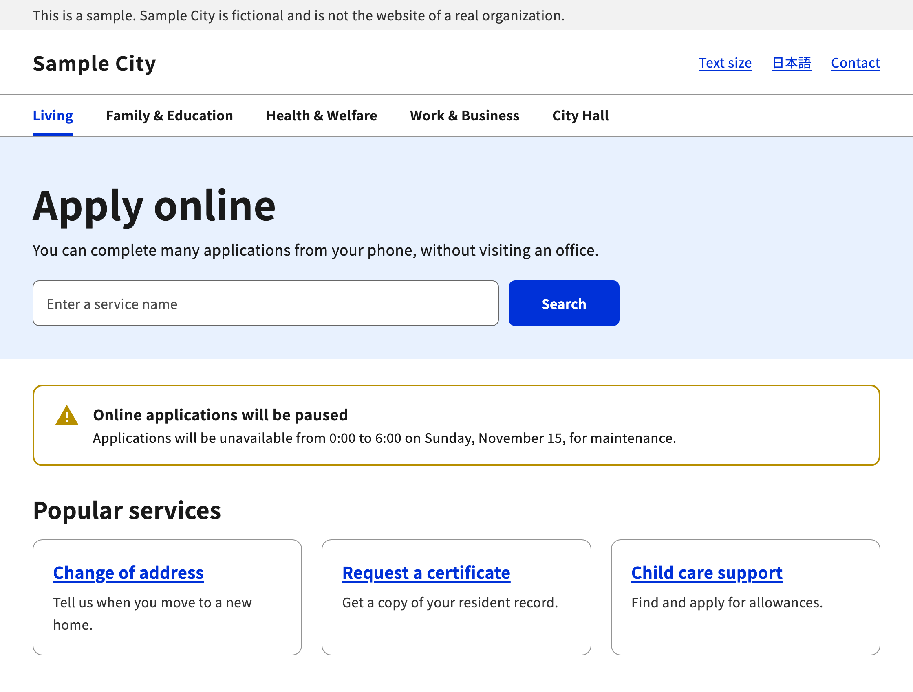
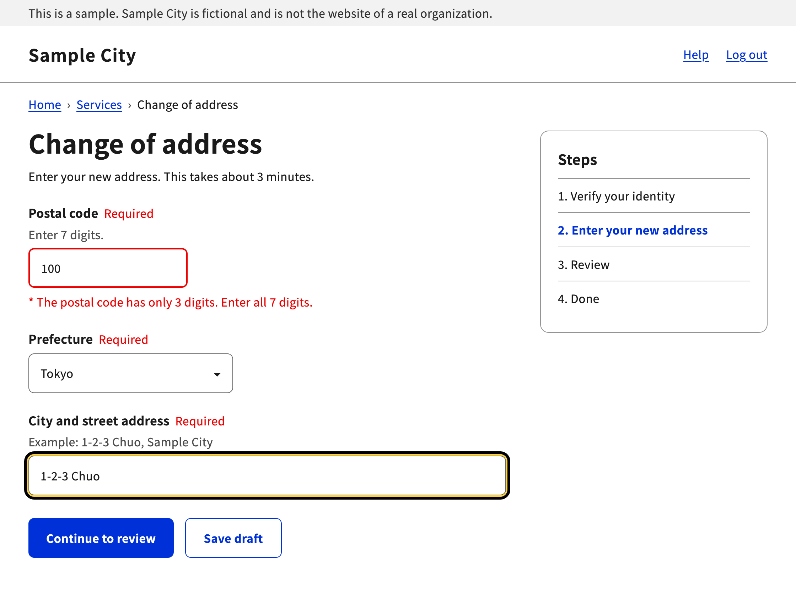
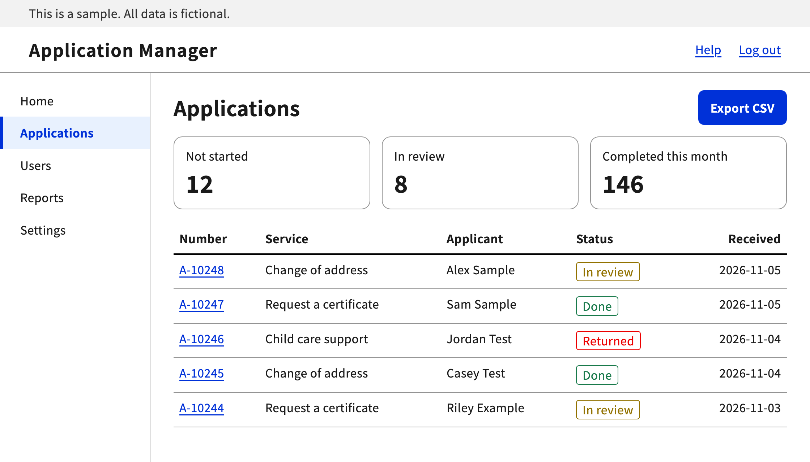

# digital-go-design-skill

[日本語](README.md) | English


## What is digital-go-design-skill?

An Agent Skill for designing, building, and reviewing web pages according to the [Digital Agency Design System (DADS) beta](https://design.digital.go.jp/dads/), the design system of Japan's Digital Agency. It works with Claude Code and Codex.

> [!NOTE]
> This skill is unofficial. It was not created or endorsed by the Digital Agency.

- Builds pages following the official rules for color, typography, spacing, layout, and more.
- Builds parts such as buttons and input fields following the official rules.
- Checks accessibility, including text legibility and easy-to-press buttons.
- Takes color and text-size values from the bundled `tokens.css`.

### When to use it

- When you want to build a website or an application form in the Digital Agency design

  For each part you use, the skill reads its page in the official documentation and follows the rules for size, states, and placement.

- When you want to check that a page meets accessibility requirements

  It checks contrast ratios, text size, how easy buttons are to press, keyboard operation, and more, using a checklist.

- When you want to build an easy-to-read business system or admin screen

  It also refers to the text rules for screens with a lot of information, such as data tables.

### Things to be aware of

- Building native apps such as iOS apps

  This skill is for websites only. It is not for native apps.

- Viewing the official figures

  The bundled documentation is Markdown and does not include figures. When a figure matters for a decision, open the official page from the `source_url` at the top of each page.

- Reading the documentation in English

  The bundled documentation is in Japanese.

- When the documentation and the tokens disagree

  The bundled tokens are updated separately from the documentation. When values disagree, as with corner radius, the skill uses the token values in code.

- When asked for a page that looks like the official Digital Agency website

  A page must not look as if the Digital Agency made it. The skill adjusts the page so that it does not use the agency's logo or name.

### Who it is for

| Who | What you get |
| --- | --- |
| Web designers and front-end developers | Pages that follow the official tokens and component specs |
| People who run public service websites | Application forms and information pages that meet accessibility requirements |
| Business system developers | Rules for building easy-to-read admin screens and data tables |

## Not included

| Item | Reason |
| --- | --- |
| Design data (Figma) | Distributed separately on Figma Community under CC BY 4.0 |
| Code snippets (HTML and React) | Distributed separately on GitHub under the MIT License |
| Illustration and icon assets | Governed by the separate terms of use for illustration and icon assets on the Digital Agency website |
| Figures | Not included in the officially distributed Markdown. View them on the official page from each page's `source_url` |
| Digital Agency logo | Not covered by the Digital Agency copyright policy |
| Noto Sans JP and Noto Sans Mono font files | Loaded from Google Fonts |

## Screens

These sample screens were made by following this skill. The city and the data are fictional.

### Public website

A home page with a notice banner, a search box, and link cards.



### Application form

An input error, and the official focus indicator of yellow and black.



### Admin screen

A compact data table with status labels.



## Getting started

### Requirements

- Claude Code or Codex
- Git

### Installation

Clone the repository into your agent's skills folder.

Claude Code:

```bash
git clone https://github.com/capsrock/digital-go-design-skill.git ~/.claude/skills/digital-go-design-skill
```

Codex:

```bash
git clone https://github.com/capsrock/digital-go-design-skill.git ~/.agents/skills/digital-go-design-skill
```

### Usage

Ask your agent something like this, and the skill will be applied.

- "Build an application form in the Digital Agency design."
- "Review this page against DADS."
- "Make this page look like a Japanese government website."

You can also call it by name.

Claude Code:

```text
/digital-go-design-skill Build a web form for an address change application
```

Codex:

```text
$digital-go-design-skill Build a web form for an address change application
```

## Design settings

### Color

Colors are set with the CSS variables in `references/tokens/tokens.css`. Use the variables rather than writing hex values directly.

#### Loading the tokens

Load `tokens.css` before your page's CSS.

```html
<link rel="stylesheet" href="tokens.css">
<link rel="stylesheet" href="app.css">
```

| File | Contents |
| --- | --- |
| `tokens.css` | All tokens. Use this one in most cases |
| `tokens-simple.css` | A subset with colors, fonts, and elevation only |

`tokens.css` and `tokens-simple.css` are under the MIT License. The files themselves contain no copyright notice, so when you distribute them, for example on a public website, include the copyright notice and license text from [references/tokens/LICENSE](references/tokens/LICENSE).

#### Types of color

| Type | Example variable | Use |
| --- | --- | --- |
| Key color | `--color-key-800` | Colors that set the site's character, such as buttons. Blue shades by default |
| Neutral | `--color-neutral-solid-gray-700` | Text, borders, backgrounds |
| Semantic | `--color-semantic-error-1` | Success, error, warning |
| Primitive | `--color-primitive-green-800` | The base colors behind the types above |

The primitive hues are `blue`, `light-blue`, `cyan`, `green`, `lime`, `yellow`, `orange`, `red`, `magenta`, and `purple`.

#### Example

```css
body {
  background: var(--color-neutral-white);
  color: var(--color-neutral-solid-gray-900);
}

.button-primary {
  background: var(--color-key-800);
  color: var(--color-neutral-white);
}

.error {
  color: var(--color-semantic-error-1);
}
```

#### Changing the key color

Do not edit `tokens.css`. Override `--color-key-*` in CSS loaded after it. Because your pages use `--color-key-*`, this one change applies across the whole site.

This example switches to green. Set all 13 steps from `50` to `1200` to the same hue.

```css
:root {
  --color-key-50: var(--color-primitive-green-50);
  --color-key-100: var(--color-primitive-green-100);
  --color-key-200: var(--color-primitive-green-200);
  --color-key-300: var(--color-primitive-green-300);
  --color-key-400: var(--color-primitive-green-400);
  --color-key-500: var(--color-primitive-green-500);
  --color-key-600: var(--color-primitive-green-600);
  --color-key-700: var(--color-primitive-green-700);
  --color-key-800: var(--color-primitive-green-800);
  --color-key-900: var(--color-primitive-green-900);
  --color-key-1000: var(--color-primitive-green-1000);
  --color-key-1100: var(--color-primitive-green-1100);
  --color-key-1200: var(--color-primitive-green-1200);
}
```

#### Rules when changing colors

| Target | Requirement |
| --- | --- |
| Text and background | Contrast ratio of at least 4.5:1 |
| Non-text elements such as borders and dividers, and their background | Contrast ratio of at least 3:1 |
| Filled button color | At least 4.5:1 against white |
| Semantic colors | Keep the link between hue and meaning |
| Focus indicator | Do not change the double structure of Yellow-300 and Black |

This table is a guide to the colors you can use for filled buttons with white labels. The usable step depends on the hue.

| Hue | First step with at least 4.5:1 against white |
| --- | --- |
| `blue` | 600 |
| `purple` | 600 |
| `magenta` | 700 |
| `light-blue` | 700 |
| `red` | 800 |
| `green` | 800 |
| `orange` | 800 |
| `cyan` | 800 |
| `yellow` | 900 |
| `lime` | 900 |

### Typeface

Use Noto Sans JP for body text and Noto Sans Mono for code. Both are under the SIL Open Font License 1.1. They are in the tokens as `--font-family-sans` and `--font-family-mono`.

```css
body {
  font-family: var(--font-family-sans); /* 'Noto Sans JP', sans-serif */
}

pre, code {
  font-family: var(--font-family-mono); /* 'Noto Sans Mono', monospace */
}
```

```html
<link rel="preconnect" href="https://fonts.googleapis.com">
<link rel="preconnect" href="https://fonts.gstatic.com" crossorigin>
<link rel="stylesheet" href="https://fonts.googleapis.com/css2?family=Noto+Sans+JP:wght@100..900&family=Noto+Sans+Mono:wght@100..900&display=swap">
```

Use two weights: N (400) and B (700). The official documentation says this does not restrict the use of the OS system fonts.

### Shape and size

| Item | Value |
| --- | --- |
| Button height | Large 56px, Medium 48px, Small 36px, X-Small 28px |
| Input field height | Large 56px, Medium 48px, Small 36px |
| Target area | At least 44px. For Small and X-Small, make up the difference with vertical spacing |
| Body text | At least 16px, with a line height of at least 1.5 times the text size |
| Corner radius | Token values 4px, 6px, 8px, 12px, 16px, 24px, 32px, and full |
| Focus indicator | The double structure of Yellow-300 and Black. Never change it |

The button and input field heights come from the descriptions of the figures in the official documentation. The documentation text does not set the width of the focus line, so check the figures on each component page.

## Project layout

```text
digital-go-design-skill/
├── SKILL.md            The skill itself
├── SOURCE.md           Sources and how to update
├── README.md           README in Japanese
├── README.en.md        This file
├── LICENSE             License for the original work
├── assets/
│   ├── social-card-jp.png  Social card (Japanese)
│   ├── social-card-en.png  Social card (English)
│   ├── jp/             Sample screens (Japanese)
│   └── en/             Sample screens (English)
└── references/
    ├── dads/           Official documentation (Markdown)
    └── tokens/         Official design tokens (CSS)
```

### Bundled versions

| Content | Version |
| --- | --- |
| Documentation | October 21, 2026 edition |
| Design tokens | `@digital-go-jp/design-tokens` 2.1.0 |

These are not updated automatically. See [SOURCE.md](SOURCE.md) for how to update them.

## Resources

| Type | Resource |
| --- | --- |
| Design system | [Digital Agency Design System beta (design.digital.go.jp)](https://design.digital.go.jp/dads/) |
| Design system | [Terms of use (design.digital.go.jp)](https://design.digital.go.jp/dads/introduction/notices/) |
| Design system | [Resources (design.digital.go.jp)](https://design.digital.go.jp/dads/resources/) |
| Design tokens | [digital-go-jp/design-tokens (github.com)](https://github.com/digital-go-jp/design-tokens) |
| Accessibility | [Web Accessibility Infrastructure Committee (waic.jp)](https://waic.jp/) |
| Accessibility | [WCAG 2.2 (w3.org)](https://www.w3.org/TR/WCAG22/) |

## Sources and license

The parts of `SKILL.md`, `README.md`, `README.en.md`, and `SOURCE.md` written by capsrock are under the MIT License ([LICENSE](LICENSE)). The following are not covered, and each stays under the terms listed below.

- Files under `references/`
- The parts of those four files that derive from the content of the Digital Agency Design System website

When you use these, follow the official terms, including the attribution requirement.

- Documentation: 出典：デジタル庁デザインシステムウェブサイト https://design.digital.go.jp/dads/ (Source: Digital Agency Design System website). `references/dads/` contains the officially distributed Markdown without changes. Its use is governed by the [terms of use](https://design.digital.go.jp/dads/introduction/notices/).
- Design tokens: [digital-go-jp/design-tokens](https://github.com/digital-go-jp/design-tokens), MIT License, Copyright (c) 2023 デジタル庁 (Digital Agency). The license text is in [references/tokens/LICENSE](references/tokens/LICENSE).
- `SKILL.md`, `README.md`, and `README.en.md`: デジタル庁デザインシステムウェブサイト https://design.digital.go.jp/dads/ をもとに capsrock が作成しました (created by capsrock based on the Digital Agency Design System website).
