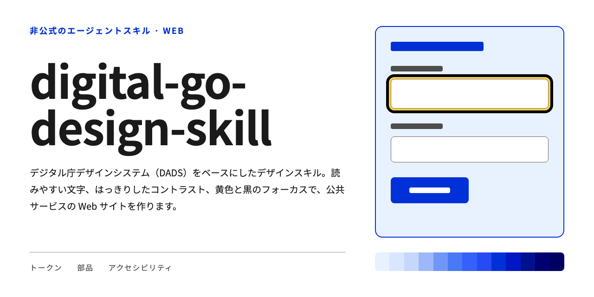
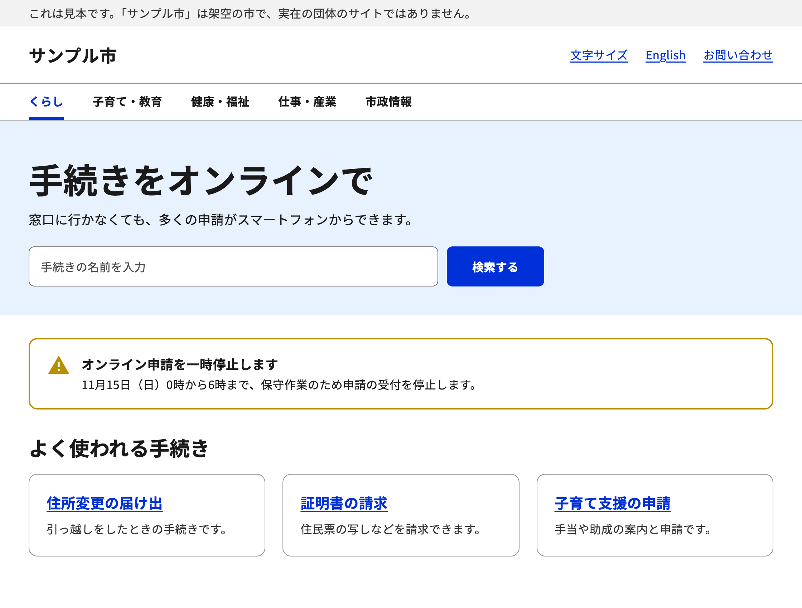
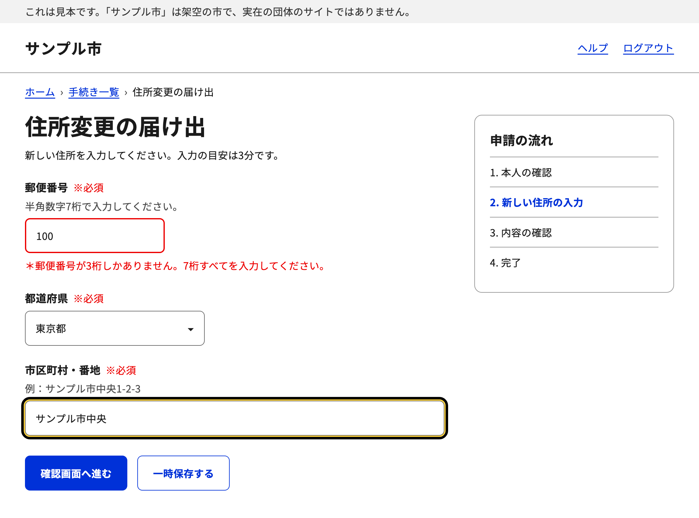
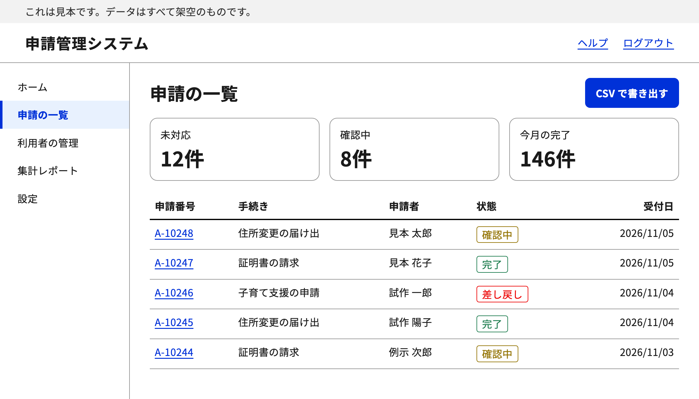

# digital-go-design-skill

日本語 | [English](README.en.md)



## digital-go-design-skill とは

[デジタル庁デザインシステムβ版](https://design.digital.go.jp/dads/)（DADS）に沿って Web サイトを設計・実装・見直しするための AI エージェント用のスキルです。Claude Code と Codex で使えます。

> [!NOTE]
> このスキルは非公式です。デジタル庁が作成・承認したものではありません。

- カラー、タイポグラフィ、余白、レイアウトなど公式のルールに沿って画面を作成します。
- ボタンや入力欄などの部品を、公式のルールに沿って作成します。
- 文字の見やすさやボタンの押しやすさなど、アクセシビリティを確認します。
- 色や文字サイズの値は、同梱の `tokens.css` から取得します。

### こんなときに使う

- デジタル庁のデザインに合わせて、Web サイトや申請フォームを作りたいとき

  使う部品ごとに公式ドキュメントのページを読み、大きさ・状態・配置の決まりに沿って作成します。

- 作った画面がアクセシビリティの基準を満たしているか確かめたいとき

  コントラスト比、文字の大きさ、ボタンの押しやすさ、キーボードでの操作などを、点検リストに沿って確認します。

- 業務システムや管理画面を、読みやすく作りたいとき

  データテーブルのように情報量の多い画面向けの、文字の決まりも参照します。

### 注意が必要なケース

- iOS などのネイティブアプリを作るとき

  このスキルは Web サイト専用です。ネイティブアプリには使用しません。

- 公式の図を見たいとき

  同梱のドキュメントは Markdown で、図版は入っていません。図の内容が判断に関わるときは、各ページの冒頭にある `source_url` から公式ページを開いてください。

- ドキュメントとトークンの値が食い違うとき

  同梱のトークンは、ドキュメントとは別に更新されています。角丸の値のように食い違う場合、実装ではトークンの値を使います。

- デジタル庁の公式サイトに見える画面を頼まれたとき

  デジタル庁が作成したように見せることはできません。ロゴや名称を使わない形に調整します。

### 対象となる方

| 想定する方 | 得られること |
| --- | --- |
| Web 制作者・フロントエンド開発者 | 公式のトークンと部品の仕様に沿った画面 |
| 公共サービスの Web 担当者 | アクセシビリティの基準を満たした申請フォームや案内ページ |
| 業務システムの開発者 | 管理画面やデータテーブルを読みやすく作るための基準 |

## 含めていないもの

| 項目 | 理由 |
| --- | --- |
| デザインデータ（Figma） | Figma Community で別に配布されています。CC BY 4.0 が適用されます |
| コードスニペット（HTML 版・React 版） | GitHub で別に配布されています。MIT License が適用されます |
| イラストレーション・アイコン素材 | デジタル庁ウェブサイトの「イラストレーション・アイコン素材利用規約」に従う素材です |
| 図版 | 公式配布の Markdown に入っていません。各ページの `source_url` から公式ページで見られます |
| デジタル庁のロゴ | デジタル庁のコピーライトポリシーの対象外です |
| Noto Sans JP と Noto Sans Mono のフォントファイル | Google Fonts から読み込みます |

## 画面の見本

このスキルのルールに沿って作成した画面の見本です。市の名前やデータは架空のものです。

### 公共向けのサイト

お知らせのバナー、検索、リンクのカードを使ったトップページです。



### 申請フォーム

入力エラーの表示と、黄色と黒の2重の線で示す公式のフォーカスです。



### 管理画面

情報量の多いデータテーブルと、状態を示すラベルです。



## 始め方

### 必要なもの

- Claude Code または Codex
- Git

### インストール

使うエージェントのスキルのフォルダに入れます。

Claude Code:

```bash
git clone https://github.com/capsrock/digital-go-design-skill.git ~/.claude/skills/digital-go-design-skill
```

Codex:

```bash
git clone https://github.com/capsrock/digital-go-design-skill.git ~/.agents/skills/digital-go-design-skill
```

### 使い方

エージェントに次のように依頼すると、スキルが適用されます。

- 「デジタル庁のデザインで申請フォームを作って」
- 「DADS に合わせてこの画面を見直して」
- 「行政サイトのような画面にして」

名前を指定して呼び出すこともできます。

Claude Code:

```text
/digital-go-design-skill 住所変更の申請フォームの Web 画面を作る
```

Codex:

```text
$digital-go-design-skill 住所変更の申請フォームの Web 画面を作る
```

## デザインの設定

### 色

色は `references/tokens/tokens.css` の CSS 変数で指定します。HEX 値を直接書かず、変数を使います。

#### 読み込み

`tokens.css` を画面の CSS より先に読み込みます。

```html
<link rel="stylesheet" href="tokens.css">
<link rel="stylesheet" href="app.css">
```

| ファイル | 内容 |
| --- | --- |
| `tokens.css` | すべてのトークン。通常はこちらを使います |
| `tokens-simple.css` | 色・フォント・エレベーションだけのサブセット |

`tokens.css` と `tokens-simple.css` は MIT License です。ファイル本文に著作権表示がないので、公開するサイトなどで配布するときは、[references/tokens/LICENSE](references/tokens/LICENSE) の著作権表示とライセンス文を添えてください。

#### 色の種類

| 種類 | 変数の例 | 用途 |
| --- | --- | --- |
| キーカラー | `--color-key-800` | ボタンなど、サイトの印象を決める色。初期値は青の階調です |
| ニュートラル | `--color-neutral-solid-gray-700` | 文字、枠線、背景 |
| セマンティック | `--color-semantic-error-1` | 成功、エラー、警告 |
| 階調（プリミティブ） | `--color-primitive-green-800` | 上の色の元になる色 |

階調の色相は `blue`、`light-blue`、`cyan`、`green`、`lime`、`yellow`、`orange`、`red`、`magenta`、`purple` です。

#### 使用例

```css
body {
  background: var(--color-neutral-white);
  color: var(--color-neutral-solid-gray-900);
}

.button-primary {
  background: var(--color-key-800);
  color: var(--color-neutral-white);
}

.error {
  color: var(--color-semantic-error-1);
}
```

#### キーカラーを変える

`tokens.css` は編集せず、後から読み込む CSS で `--color-key-*` を上書きします。画面側は `--color-key-*` を使っているので、ここだけでサイト全体の色が変わります。

緑にする例です。`50` から `1200` までの13段階すべてを、同じ色相に揃えます。

```css
:root {
  --color-key-50: var(--color-primitive-green-50);
  --color-key-100: var(--color-primitive-green-100);
  --color-key-200: var(--color-primitive-green-200);
  --color-key-300: var(--color-primitive-green-300);
  --color-key-400: var(--color-primitive-green-400);
  --color-key-500: var(--color-primitive-green-500);
  --color-key-600: var(--color-primitive-green-600);
  --color-key-700: var(--color-primitive-green-700);
  --color-key-800: var(--color-primitive-green-800);
  --color-key-900: var(--color-primitive-green-900);
  --color-key-1000: var(--color-primitive-green-1000);
  --color-key-1100: var(--color-primitive-green-1100);
  --color-key-1200: var(--color-primitive-green-1200);
}
```

#### 色を変えるときの条件

| 対象 | 条件 |
| --- | --- |
| テキストと背景 | コントラスト比 4.5:1 以上 |
| 枠線、ディバイダーなどの非テキスト要素と背景 | コントラスト比 3:1 以上 |
| 塗りボタンの色 | 白に対して 4.5:1 以上 |
| セマンティックカラー | 色相と意味の結びつきを変えない |
| フォーカスインジケーター | Yellow-300 と Black の2重構造から変えない |

白いラベルの塗りボタンに使える色の目安です。色相によって、使える段階が変わります。

| 色相 | 白に対して 4.5:1 以上になる最初の段階 |
| --- | --- |
| `blue` | 600 |
| `purple` | 600 |
| `magenta` | 700 |
| `light-blue` | 700 |
| `red` | 800 |
| `green` | 800 |
| `orange` | 800 |
| `cyan` | 800 |
| `yellow` | 900 |
| `lime` | 900 |

### 書体

本文は Noto Sans JP、コードは Noto Sans Mono を使います。どちらも SIL Open Font License 1.1 の書体です。トークンには `--font-family-sans` と `--font-family-mono` として入っています。

```css
body {
  font-family: var(--font-family-sans); /* 'Noto Sans JP', sans-serif */
}

pre, code {
  font-family: var(--font-family-mono); /* 'Noto Sans Mono', monospace */
}
```

```html
<link rel="preconnect" href="https://fonts.googleapis.com">
<link rel="preconnect" href="https://fonts.gstatic.com" crossorigin>
<link rel="stylesheet" href="https://fonts.googleapis.com/css2?family=Noto+Sans+JP:wght@100..900&family=Noto+Sans+Mono:wght@100..900&display=swap">
```

太さは N（400）と B（700）の2段階を使います。公式の文書では、OS のシステムフォントの使用を制限するものではないとされています。

### 形の基準

| 項目 | 値 |
| --- | --- |
| ボタンの高さ | Large 56px、Medium 48px、Small 36px、X-Small 28px |
| 入力欄の高さ | Large 56px、Medium 48px、Small 36px |
| 押せる範囲 | 44px 以上。Small と X-Small は上下の余白で確保します |
| 本文の文字 | 16px 以上。行の高さは文字の 1.5 倍以上 |
| 角丸 | トークンの 4px、6px、8px、12px、16px、24px、32px、full |
| フォーカスの表示 | Yellow-300 と Black の2重構造。いかなる場合も変更しません |

ボタンと入力欄の高さは、公式の文書の図の説明にある値です。フォーカスの線の太さは文章では定められていないので、各部品のページの図を見てください。

## 構成

```text
digital-go-design-skill/
├── SKILL.md            スキル本体
├── SOURCE.md           出典と更新のしかた
├── README.md           このファイル
├── README.en.md        英語版の README
├── LICENSE             自作部分のライセンス
├── assets/
│   ├── social-card-jp.png  ソーシャルカード（日本語）
│   ├── social-card-en.png  ソーシャルカード（英語）
│   ├── jp/             画面の見本（日本語）
│   └── en/             画面の見本（英語）
└── references/
    ├── dads/           公式ドキュメント（Markdown）
    └── tokens/         公式デザイントークン（CSS）
```

### 同梱している版

| 内容 | 版 |
| --- | --- |
| ドキュメント | 2026年10月21日版 |
| デザイントークン | `@digital-go-jp/design-tokens` 2.1.0 |

自動では更新されません。更新方法は [SOURCE.md](SOURCE.md) を参照してください。

## 関連リソース

| 種別 | リソース |
| --- | --- |
| デザインシステム | [デジタル庁デザインシステムβ版（design.digital.go.jp）](https://design.digital.go.jp/dads/) |
| デザインシステム | [利用上の注意事項（design.digital.go.jp）](https://design.digital.go.jp/dads/introduction/notices/) |
| デザインシステム | [リソース（design.digital.go.jp）](https://design.digital.go.jp/dads/resources/) |
| デザイントークン | [digital-go-jp/design-tokens（github.com）](https://github.com/digital-go-jp/design-tokens) |
| アクセシビリティ | [ウェブアクセシビリティ基盤委員会（waic.jp）](https://waic.jp/) |
| アクセシビリティ | [WCAG 2.2（w3.org）](https://www.w3.org/TR/WCAG22/) |

## 出典とライセンス

`SKILL.md`、`README.md`、`README.en.md`、`SOURCE.md` のうち、capsrock が書いた部分は MIT License です（[LICENSE](LICENSE)）。次のものは対象外で、それぞれ下記の条件に従います。

- `references/` の中のファイル
- 上の4ファイルのうち、デジタル庁デザインシステムウェブサイトのコンテンツに由来する部分

これらを使うときは、出典の記載などの公式の条件を守ってください。

- ドキュメント: 出典：デジタル庁デザインシステムウェブサイト https://design.digital.go.jp/dads/ 。`references/dads/` は公式配布の Markdown を変更せずに収録しています。利用条件は[利用上の注意事項](https://design.digital.go.jp/dads/introduction/notices/)に従います。
- デザイントークン: [digital-go-jp/design-tokens](https://github.com/digital-go-jp/design-tokens)、MIT License、Copyright (c) 2023 デジタル庁。ライセンス文は [references/tokens/LICENSE](references/tokens/LICENSE) にあります。
- `SKILL.md`、`README.md`、`README.en.md`: デジタル庁デザインシステムウェブサイト https://design.digital.go.jp/dads/ をもとに capsrock が作成しました。
